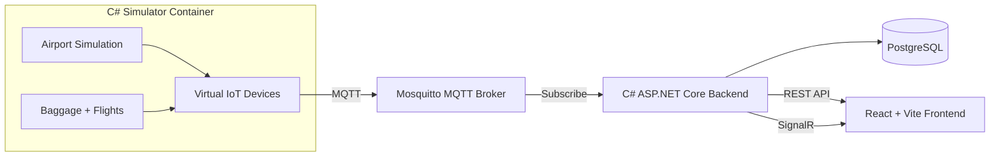
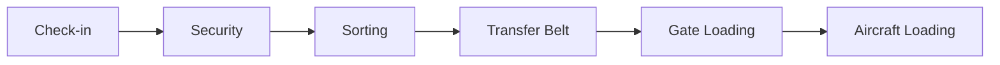
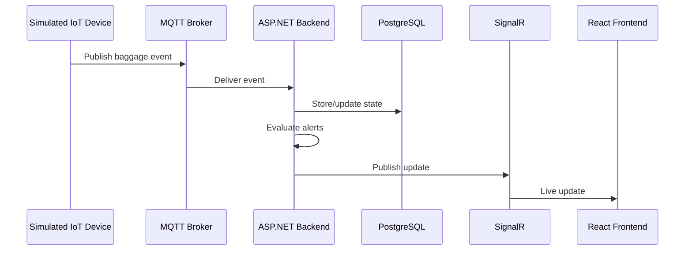

# Airport Baggage Tracking IoT System

## Overview

This project is a simulated **IoT-based airport baggage tracking system** using **MQTT** for communication between simulated airport devices and a backend service.

The system simulates several airports and tracks luggage as it moves through the different stages of airport baggage handling.

Each stage of the luggage flow is represented as a simulated **IoT device**, for example:

- Check-in scanner
- Security scanner
- Sorting system
- Transfer belt
- Gate loading scanner
- Aircraft loading scanner

The system provides real-time monitoring through a React frontend containing:

- A visual airport map
- Airport health indicators
- Baggage search
- Alerts
- Device status
- Statistics
- Live baggage events

All components run as Docker containers and can be started using Docker Compose.

---

# System Goals

The system should demonstrate several core IoT concepts:

- MQTT publish/subscribe communication
- Multiple independently simulated IoT devices
- Real-time event processing
- Device monitoring
- Baggage tracking
- Alert generation
- Persistent storage
- Real-time frontend updates
- Multi-airport visualization

Physical IoT hardware is not required. The IoT devices are simulated in software.

---

# Technology Stack

## Frontend

- React
- TypeScript
- Vite
- Leaflet
- OpenStreetMap
- SignalR client

The frontend is responsible only for displaying and interacting with system data.

---

## Backend

- C#
- ASP.NET Core Web API
- MQTTnet
- Entity Framework Core
- SignalR

The backend receives IoT events through MQTT, tracks baggage state, creates alerts, persists data and exposes data to the frontend.

---

## Simulator

- C#
- .NET Worker Service
- MQTTnet

The simulator generates:

- Airports
- Flights
- Bags
- IoT devices
- Baggage movement
- Device heartbeat messages
- Normal events
- Failure scenarios

---

## Infrastructure

- Eclipse Mosquitto
- PostgreSQL
- Docker
- Docker Compose

---

# Container Architecture

The project consists of five main containers.

```text
docker-compose.yml
│
├── frontend
│   └── React + Vite
│
├── backend
│   └── C# ASP.NET Core
│
├── simulator
│   └── C# .NET Worker Service
│
├── mqtt
│   └── Eclipse Mosquitto
│
└── postgres
    └── PostgreSQL
```

The complete system can be started using:

```bash
docker compose up
```

---

# Deployment Architecture



---

# Communication Flow

The main system flow is:

```text
Simulator
    |
    | MQTT
    v
Mosquitto
    |
    | MQTT subscriptions
    v
Backend
    |
    +------ PostgreSQL
    |
    +------ SignalR
                |
                v
             Frontend
```

The simulator never writes directly to the database.

The frontend never communicates directly with the simulator or MQTT broker.

The backend acts as the central processing layer.

---

# IoT Device Model

Each airport processing stage is represented as a simulated IoT device.

For example, Heathrow could contain:

```text
LHR-CHECKIN-01
LHR-CHECKIN-02

LHR-SECURITY-01
LHR-SECURITY-02

LHR-SORT-01
LHR-SORT-02
LHR-SORT-03

LHR-BELT-A

LHR-GATE-A12

LHR-AIRCRAFT-LOAD-01
```

Copenhagen could contain:

```text
CPH-CHECKIN-01
CPH-SECURITY-01
CPH-SORT-01
CPH-GATE-B06
CPH-AIRCRAFT-LOAD-01
```

These devices are logically independent MQTT clients but do not need separate Docker containers.

Instead, all simulated devices run inside the simulator container.

```text
Simulator Container
│
├── LHR-CHECKIN-01
├── LHR-SECURITY-01
├── LHR-SORT-01
├── LHR-GATE-A12
├── CPH-CHECKIN-01
├── CPH-SORT-01
├── AMS-SORT-01
└── ...
```

This allows the system to simulate hundreds or thousands of devices without creating hundreds of containers.

---

# Simulator Architecture

The simulator can be structured approximately as follows:

```text
Simulator
│
├── AirportSimulator
├── FlightSimulator
├── BaggageSimulator
│
├── Devices
│   ├── CheckInDevice
│   ├── SecurityDevice
│   ├── SortingDevice
│   ├── TransferDevice
│   ├── GateDevice
│   └── AircraftLoadingDevice
│
└── MqttPublisher
```

A possible common device interface:

```csharp
public interface IIotDevice
{
    string DeviceId { get; }
    string AirportCode { get; }
    DeviceType Type { get; }

    Task ProcessBagAsync(Bag bag);
}
```

---

# Baggage Flow

A normal bag may move through the following stages:



Each transition causes the corresponding IoT device to publish an MQTT event.

---

# Example Baggage Route

Bag:

```text
BG-1042
```

Flight:

```text
BA281
```

Expected route:

```text
LHR-CHECKIN-04
      ↓
LHR-SECURITY-02
      ↓
LHR-SORT-03
      ↓
LHR-BELT-A
      ↓
LHR-GATE-A12
      ↓
LHR-AIRCRAFT-LOAD-01
```

The backend compares incoming MQTT events against this expected route.

---

# MQTT

The MQTT broker is provided by Eclipse Mosquitto.

The simulator publishes messages while the backend subscribes to the relevant topics.

---

# Suggested MQTT Topic Structure

## Baggage Events

```text
airport/{airportCode}/baggage/{bagId}/event
```

Example:

```text
airport/LHR/baggage/BG-1042/event
```

---

## Device Heartbeats

```text
airport/{airportCode}/device/{deviceId}/heartbeat
```

Example:

```text
airport/LHR/device/LHR-SORT-03/heartbeat
```

---

## Device Status

```text
airport/{airportCode}/device/{deviceId}/status
```

---

## Airport Alerts

```text
airport/{airportCode}/alerts
```

---

## Global Events

```text
system/events
system/alerts
system/simulation/control
```

---

# MQTT Message Formats

JSON is used for MQTT message payloads.

## Baggage Event

Topic:

```text
airport/LHR/baggage/BG-1042/event
```

Payload:

```json
{
  "eventId": "evt-000245",
  "bagId": "BG-1042",
  "flightId": "BA281",
  "airportCode": "LHR",
  "deviceId": "LHR-SORT-03",
  "stepType": "sorting",
  "zone": "Terminal-2",
  "timestamp": "2026-08-24T10:03:12Z",
  "eventType": "scan"
}
```

---

## Device Heartbeat

Topic:

```text
airport/LHR/device/LHR-SORT-03/heartbeat
```

Payload:

```json
{
  "deviceId": "LHR-SORT-03",
  "airportCode": "LHR",
  "timestamp": "2026-08-24T10:03:15Z",
  "status": "online",
  "bagsProcessed": 532
}
```

---

## Alert

Topic:

```text
airport/LHR/alerts
```

Payload:

```json
{
  "alertId": "ALT-0091",
  "severity": "critical",
  "alertType": "misrouted_baggage",
  "bagId": "BG-1042",
  "flightId": "BA281",
  "airportCode": "LHR",
  "deviceId": "LHR-GATE-B37",
  "timestamp": "2026-08-24T10:08:00Z",
  "message": "Bag detected at unexpected gate",
  "expectedDevice": "LHR-GATE-A12",
  "actualDevice": "LHR-GATE-B37"
}
```

---

# Backend Architecture

The backend is an ASP.NET Core application.

Suggested structure:

```text
Backend
│
├── Controllers
│   ├── AirportsController
│   ├── BagsController
│   ├── AlertsController
│   ├── DevicesController
│   └── StatisticsController
│
├── Mqtt
│   └── MqttConsumer
│
├── Services
│   ├── BaggageTrackingService
│   ├── AlertService
│   ├── AirportStatusService
│   ├── DeviceService
│   └── StatisticsService
│
├── Hubs
│   └── AirportHub
│
└── Data
    ├── AppDbContext
    └── Entities
```

---

# Backend Responsibilities

## MQTT Consumer

Subscribes to MQTT topics and receives events generated by the simulator.

Example:

```text
airport/+/baggage/+/event
airport/+/device/+/heartbeat
```

---

## Baggage Tracking Service

Responsible for:

- Tracking current bag location
- Updating bag status
- Maintaining baggage event history
- Checking the expected next step
- Associating baggage with flights

---

## Alert Service

Responsible for detecting problems.

Examples:

- Delayed bag
- Stuck bag
- Bag likely to miss flight
- Bag routed to wrong location
- Bag detected at wrong airport
- Missing baggage updates

---

## Device Service

Responsible for:

- Monitoring device heartbeats
- Tracking online/offline state
- Detecting device failures
- Maintaining device information

---

## Statistics Service

Responsible for calculating:

- Bags processed
- Delays
- Misroutes
- Processing times
- Alerts per airport
- Device uptime
- Current airport load

---

# PostgreSQL

PostgreSQL stores persistent system state.

Suggested main tables/entities:

```text
Airports
Flights
Bags
Devices
BaggageEvents
Alerts
```

---

# Example Bag Entity

```json
{
  "bagId": "BG-1042",
  "flightId": "BA281",
  "originAirport": "LHR",
  "destinationAirport": "AMS",
  "currentAirport": "LHR",
  "currentStep": "sorting",
  "status": "warning"
}
```

---

# Example Device Entity

```json
{
  "deviceId": "LHR-SORT-03",
  "airportCode": "LHR",
  "stepType": "sorting",
  "zone": "Terminal-2",
  "status": "online"
}
```

---

# Frontend

The frontend uses React, TypeScript and Vite.

Suggested structure:

```text
frontend/
└── src/
    ├── pages/
    │   ├── MapPage.tsx
    │   ├── AirportPage.tsx
    │   ├── AlertsPage.tsx
    │   ├── SearchPage.tsx
    │   ├── StatisticsPage.tsx
    │   └── DevicesPage.tsx
    │
    ├── components/
    │   ├── AirportMap.tsx
    │   ├── AirportMarker.tsx
    │   ├── AlertTable.tsx
    │   ├── BagTimeline.tsx
    │   └── Navbar.tsx
    │
    └── services/
        ├── api.ts
        └── signalr.ts
```

---

# Frontend Navigation

Suggested navigation:

```text
Map
Airports
Alerts
Search
Statistics
Devices
Live Feed
```

---

# Main Map View

The main screen contains a visual map of all simulated airports.

Leaflet and OpenStreetMap can be used for the map.

Each airport has a marker representing its current status.

## Airport Status

### Green

Normal operation.

```text
No active severe alerts.
```

### Yellow

One or more warnings.

Examples:

- Bag stuck in sorting
- Bag delayed
- Bag may miss upcoming flight
- Device temporarily offline

### Red

Critical problem.

Examples:

- Bag routed to wrong airport
- Bag loaded for wrong flight
- Serious device failure
- Missing luggage

---

# Example Map Behavior

```text
             Airport Monitoring

      ● LHR
      RED

                    ● AMS
                    GREEN


             ● CPH
             YELLOW
```

If a bag becomes stuck at Heathrow:

```text
LHR

GREEN
  ↓
Bag delayed
  ↓
YELLOW
```

If the same bag is then routed to the wrong destination:

```text
YELLOW
  ↓
Critical routing error
  ↓
RED
```

---

# Airport Details

Clicking an airport marker should open an airport details panel.

Example:

```text
Heathrow Airport (LHR)

Status: RED

Active bags:        1,243
Bags delayed:          12
Critical alerts:        2
Devices online:        47
Devices offline:        1
```

The view could also display the latest baggage events.

---

# Search View

Users should be able to search by:

- Bag ID
- Flight
- Airport
- Alert type

Example:

```text
Search: BG-1042
```

Result:

```text
Bag: BG-1042
Flight: BA281

Origin:      LHR
Destination: AMS

Current location:
LHR-GATE-B37

Expected:
LHR-GATE-A12

Status:
MISROUTED
```

---

# Bag Timeline

The frontend can visualize the baggage journey.

```text
Check-in
   ✓
   |
Security
   ✓
   |
Sorting
   ✓
   |
Gate A12
   X
   |
Gate B37
   !
```

This makes it easy to understand where the route went wrong.

---

# Alerts View

The alert page should show active and historical alerts.

Suggested columns:

| Severity | Bag     | Airport | Type      | Device      | Time  |
| -------- | ------- | ------- | --------- | ----------- | ----- |
| Yellow   | BG-1042 | LHR     | Delayed   | LHR-SORT-03 | 10:03 |
| Red      | BG-2081 | AMS     | Misrouted | AMS-GATE-12 | 10:07 |

---

# Statistics View

Possible statistics include:

- Bags processed today
- Bags currently in transit
- Average baggage processing time
- Delayed bags
- Misrouted bags
- Missing bags
- Alerts per airport
- Device uptime
- Busiest airport

Suggested charts:

- Bags processed per hour
- Alerts per airport
- Alerts grouped by severity
- Average processing time per stage
- Device uptime
- Baggage volume per airport

---

# Real-Time Frontend Updates

SignalR can be used to push updates from the backend to React.



This means the frontend does not need to continuously poll the backend.

---

# Alerts

## Delayed Baggage

The bag is progressing slower than expected.

Severity:

```text
Yellow
```

---

## Stuck Baggage

The bag has remained at the same stage for too long.

Severity:

```text
Yellow
```

---

## At Risk of Missing Flight

The departure time is approaching but the bag has not reached the required stage.

Severity:

```text
Yellow
```

The alert could escalate to red when departure becomes imminent.

---

## Misrouted Baggage

The bag appears at a location that does not match its expected route.

Severity:

```text
Red
```

---

## Wrong Airport

A bag is detected at an airport that does not match its route.

Severity:

```text
Red
```

---

## Missing Baggage

No expected device has reported the bag within a configured amount of time.

Severity:

```text
Red
```

---

## Device Offline

A device stops sending heartbeat messages.

Severity:

```text
Yellow
```

A critical device could eventually escalate to:

```text
Red
```

---

# Simulation Scenarios

The simulator should generate both correct and incorrect behavior.

## Normal Behavior

- Bag moves through correct route
- Devices report scans
- Flights depart normally
- Devices send heartbeats

---

## Delayed Bag

A bag pauses at one stage longer than expected.

```text
CHECK-IN
   ↓
SECURITY
   ↓
SORTING
   ↓
   X

No movement for configured threshold
```

Result:

```text
Yellow alert
```

---

## Misrouted Bag

Expected:

```text
LHR-SORT-03
    ↓
LHR-GATE-A12
```

Actual:

```text
LHR-SORT-03
    ↓
LHR-GATE-B37
```

Result:

```text
Red alert
```

---

## Wrong Airport

Expected route:

```text
LHR
 ↓
AMS
```

Actual event:

```text
airport/CDG/baggage/BG-1042/event
```

Result:

```text
Critical alert
```

---

## Device Failure

A device stops sending heartbeat messages.

```text
LHR-SORT-03

10:01 heartbeat
10:02 heartbeat
10:03 heartbeat
...
no heartbeat
```

Result:

```text
Device Offline
```

---

# Simulator Configuration

Simulation settings can be configurable.

Example:

```json
{
  "bagCount": 500,
  "eventIntervalMs": 500,
  "stuckBagProbability": 0.02,
  "misrouteProbability": 0.01,
  "deviceFailureProbability": 0.005
}
```

Airport configuration could also be defined externally.

Example:

```json
{
  "airports": [
    {
      "code": "LHR",
      "checkInDevices": 5,
      "securityDevices": 3,
      "sortingDevices": 8,
      "gateDevices": 10
    },
    {
      "code": "CPH",
      "checkInDevices": 4,
      "securityDevices": 2,
      "sortingDevices": 5,
      "gateDevices": 8
    }
  ]
}
```

---

# Docker Compose Concept

A simplified setup:

```yaml
services:
  mqtt:
    image: eclipse-mosquitto
    ports:
      - "1883:1883"

  postgres:
    image: postgres
    environment:
      POSTGRES_DB: baggage
      POSTGRES_USER: baggage
      POSTGRES_PASSWORD: baggage

  backend:
    build: ./backend
    depends_on:
      - mqtt
      - postgres

  simulator:
    build: ./simulator
    depends_on:
      - mqtt

  frontend:
    build: ./frontend
    depends_on:
      - backend
```

---

# Suggested Repository Structure

```text
airport-baggage-iot/
│
├── docker-compose.yml
│
├── mqtt/
│   └── mosquitto.conf
│
├── backend/
│   ├── Dockerfile
│   └── src/
│
├── simulator/
│   ├── Dockerfile
│   └── src/
│
├── frontend/
│   ├── Dockerfile
│   └── src/
│
├── docs/
│
└── README.md
```

---

# Example Demo

A possible demonstration sequence:

1. Start the entire environment.

```bash
docker compose up
```

2. Open the frontend.

3. The map initially shows:

```text
LHR ● GREEN
CPH ● GREEN
AMS ● GREEN
```

4. Simulated baggage begins moving through the airports.

5. A bag becomes stuck in Heathrow sorting.

```text
BG-1042
LHR-SORT-03
```

Heathrow changes:

```text
GREEN -> YELLOW
```

6. Open Heathrow to see the alert.

7. The simulator sends another bag to the wrong gate.

```text
Expected:
LHR-GATE-A12

Actual:
LHR-GATE-B37
```

Heathrow changes:

```text
YELLOW -> RED
```

8. Search for the bag.

9. Display its full baggage timeline.

10. Open the statistics page to view system-wide results.

---

# Why Docker Is Used

Docker separates the different responsibilities of the application.

```text
Container               Responsibility

frontend       ->       User interface
backend        ->       System logic
simulator      ->       Virtual IoT devices
mqtt           ->       IoT communication
postgres       ->       Persistent storage
```

This makes the complete environment reproducible and allows all team members to run the same system.

---

# Docker Containers vs IoT Devices

A key architectural distinction is that an IoT device does not correspond to a Docker container.

The simulator container may contain hundreds of independent virtual IoT devices.

```text
Docker Host
│
├── Simulator Container
│   ├── LHR-CHECKIN-01
│   ├── LHR-CHECKIN-02
│   ├── LHR-SECURITY-01
│   ├── LHR-SORT-01
│   ├── CPH-CHECKIN-01
│   ├── CPH-SORT-01
│   └── ...
│
├── MQTT Broker Container
│
├── ASP.NET Backend Container
│
├── PostgreSQL Container
│
└── React Frontend Container
```

The simulated devices remain separate at the IoT/MQTT level through:

- Unique device IDs
- Separate state
- Independent heartbeat messages
- Device-specific MQTT topics
- Independent simulated failures

---

# Summary

The system consists of five major Docker containers:

```text
React + Vite
ASP.NET Core
C# Simulator
Mosquitto
PostgreSQL
```

The C# simulator represents the airport infrastructure and contains many virtual IoT devices.

These devices publish baggage and device events through MQTT.

The ASP.NET Core backend consumes these events, tracks baggage, detects abnormal behavior and stores the system state in PostgreSQL.

SignalR pushes updates to the React frontend in real time.

The frontend provides a visual airport map where airport status can immediately change depending on current alerts:

```text
Green  -> normal
Yellow -> warning / delay
Red    -> critical / misroute
```

The final system therefore demonstrates a complete IoT workflow:

```text
Simulated Device
      ↓
     MQTT
      ↓
 Event Processing
      ↓
 Persistence + Alerts
      ↓
 Real-Time Visualization
```
