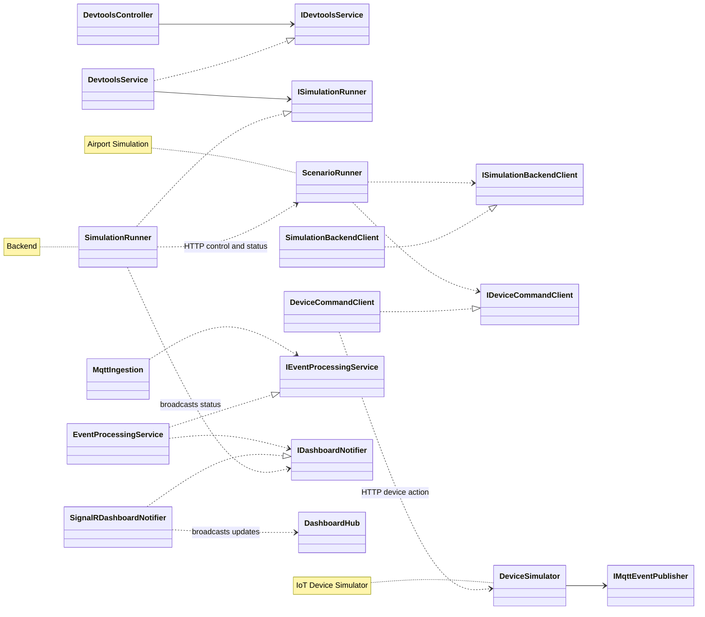
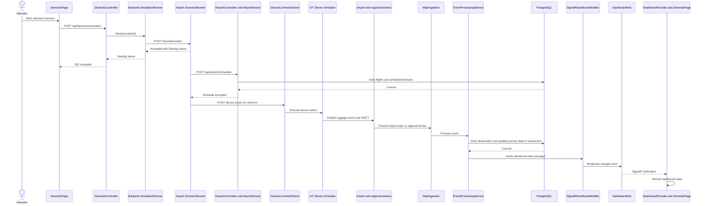

# Airport luggage tracking

Airport Simulation (ASP.NET Core) sends flight schedules to the backend. IoT Device Simulator publishes scanner and gate events to each airport's Mosquitto broker. Airport brokers bridge `airport/<CODE>/#` to the regional broker, and the backend consumes `airport/#` from the regional broker. PostgreSQL and the backend own application data; React displays it and receives live dashboard and simulation-status updates through SignalR.

## Start the server

Copy `.env.example` to `.env` and set `POSTGRES_PASSWORD`. Ensure the external `ingress` network used by your Cloudflare tunnel exists, then start the stack:

```sh
docker compose up -d
```

Compose runs PostgreSQL, the default `regional`, `aar`, and `cph` brokers, backend, frontend, Airport Simulation, and IoT Device Simulator. It does not publish broker or frontend ports to the host. Cloudflare/tunnel routing remains your existing deployment setup; route to `http://frontend:80` on `ingress`. Cloudflare Access is unchanged.

Keep `.env` and the `postgres-data`, `airport-broker-config`, and other named volumes when upgrading. For an existing database volume, set `POSTGRES_PASSWORD` to the password already configured for that database before starting the new stack. PostgreSQL credentials come from `.env`; broker access is anonymous and topic-limited by ACLs. The Docker socket is mounted into the backend so it can create Mosquitto containers for additional airports.

## Simulation and event flow

In **Devtools**, choose a scenario and start it. The backend preserves the start, stop, and status endpoints and forwards control to Airport Simulation. Airport Simulation registers flight schedules, including scheduled arrival times, and sends actual departure and arrival times directly to the backend over HTTP. A first luggage `checkin` event includes the planned flight ID; the backend creates the trip, journey, and flight assignment when it processes that event. Luggage arrival remains a scanner event over MQTT. No run manifest or run-registration request is used.

Airport Simulation sends each device event to the IoT Device Simulator over the private Compose network. The device simulator publishes anonymously to the local airport broker. The airport broker ACL permits that airport's `airport/<CODE>/#` topics, and its bridge sends those topics to the regional broker. The backend subscribes to `airport/#` there.

Airport records AAR and CPH and their default scanner/gate devices are seeded at startup. Use **Airports** to register more airports. Registration provisions a broker, writes its config into the shared `airport-broker-config` volume, starts a Mosquitto container on the private `airport-brokers` network, and seeds the airport's default scanner and gate devices. Each airport broker initiates its bridge to `regional`. Broker ACLs restrict topics, but anonymous ACLs do not authenticate the broker's claimed client ID.

Simulation status includes `Idle`, `Starting`, `Running`, `Completed`, `Stopped`, `Failed`, and `Interrupted`, along with event progress. Stop finishes the action currently in progress, then stops before the next scheduled action. If the simulation is waiting for a future action, it stops during that wait. Events and data from completed actions remain stored. Starting again begins the selected scenario from the beginning with a new run ID; it does not clear previous run data. The backend broadcasts status changes through SignalR, and Devtools uses the initial status response plus live updates. Backend status is persisted in `simulation-runs`.

## Architecture diagrams

The class diagram shows the main control and event-processing classes. The two runners have similar names but live in different applications: `SimulationRunner` is in the backend, and `ScenarioRunner` is in Airport Simulation.



This sequence follows one scenario start through a luggage check-in event and its dashboard notification. Airport Simulation registers the schedule before sending device actions. The backend polls simulation status separately while the run is active and sends status changes through SignalR.



## Build and publish images

Pushes to `main` validate all four Docker images. To publish, manually run **Build and publish** from `main` and enable the Docker Hub publish option. The workflow publishes `latest` and the commit SHA tags for backend, frontend, Airport Simulation, and IoT Device Simulator, then triggers Watchtower for the corresponding application container. Configure repository secrets `DOCKER_ACCESS_TOKEN`, `WATCHTOWER_TOKEN`, and `WATCHTOWER_URL`; Docker Hub username is `andreasfrost1004`.

On the server, update the stack with:

```sh
docker compose up -d
```

Watchtower runs from your separate Compose file. Only the backend, frontend, and two simulation applications carry its enable label; brokers do not.

## API

| Endpoint | Controller / handler | Purpose |
| --- | --- | --- |
| GET /api/airports | AirportsController | Airport metadata and status |
| POST /api/airports | AirportsController | Register metadata, provision a broker, and seed default devices |
| POST /api/airports/schedule | AirportsController | Register a scenario's flight schedule and devices |
| POST /api/airports/flights/{flightId}/departure | AirportsController | Record actual flight departure |
| POST /api/airports/flights/{flightId}/arrival | AirportsController | Record actual flight arrival |
| GET /api/airports/{id} | AirportsController | Flights and alert history |
| GET /api/luggage/{id} | LuggageController | Luggage states and observations |
| GET /api/alerts | AlertsController | Alerts and filters |
| GET /api/statistics | StatisticsController | Persisted counts |
| GET /api/devtools/scenarios | DevtoolsController | Available scenarios |
| GET /api/devtools/simulation | DevtoolsController | Current/last simulation status |
| POST /api/devtools/simulation | DevtoolsController | Start a scenario |
| POST /api/devtools/simulation/stop | DevtoolsController | Stop the active scenario |
| POST /api/devtools/database/clear | DevtoolsController | Clear application data and remove dynamically provisioned airport brokers and their generated configuration |
| POST /api/devtools/database/seed | DevtoolsController | Add default airport/device records |
| /hub | DashboardHub | SignalR dashboard refresh and simulation-status notifications |

## Development notes

The backend uses .NET 10, PostgreSQL, MQTTnet, and Docker.DotNet. The Airport Simulation and IoT Device Simulator are separate .NET 10 ASP.NET Core applications. Scenario definitions are stored in `scenarios`.
